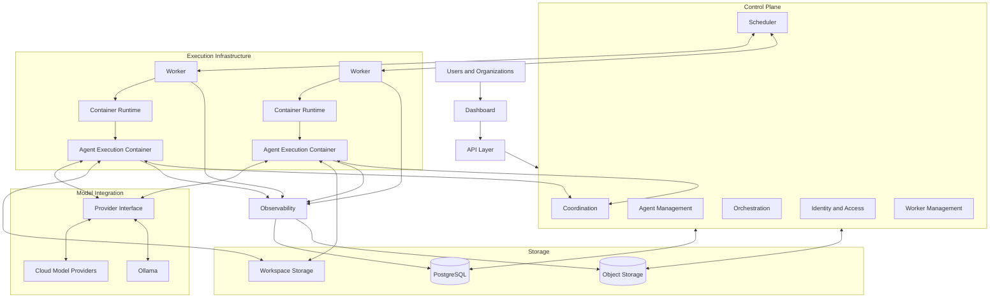

# Kairo Architecture

## 1. Overview

Kairo is an open-source, cloud-native platform for building, running, and managing AI agents.

It provides a native agent harness, isolated execution environments, model integrations, multi-agent coordination, persistent workspaces, and execution observability.

Kairo separates agent intelligence, execution, orchestration, and infrastructure into distinct components. These components communicate through defined interfaces, allowing the platform to support different models, execution environments, and agent implementations without coupling them to a single deployment model.

The architecture supports individual agents and hierarchical agent teams, persistent and ephemeral workloads, and both self-hosted and managed deployments.

### Architectural goals

- Run agents in isolated, resource-controlled environments.
- Give every agent its own harness instance and execution state.
- Coordinate multiple agents without requiring direct agent-to-agent connections.
- Support persistent and temporary agents, workspaces, and memory.
- Support cloud-hosted models and locally served models through Ollama.
- Provide reliable execution, checkpoint recovery, and failure handling.
- Make agent activity observable and inspectable.
- Support single-machine and distributed deployments.
- Keep infrastructure lightweight and modular without sacrificing platform capabilities.

## 2. Architectural Principles

### 2.1 Modular architecture

Kairo uses clearly separated components with defined responsibilities and interfaces.

Logical separation does not require every component to run as a separate service. Components are grouped into a small number of deployable applications wherever independent deployment or scaling is unnecessary.

The control plane is implemented as a modular application rather than an initially distributed collection of microservices.

### 2.2 Agent independence

Every agent has its own identity, configuration, harness state, private context, model configuration, and permissions.

Agents do not share execution processes or private context. They communicate and collaborate through Kairo's coordination layer.

### 2.3 Execution isolation

Every agent execution runs in its own isolated container. Containers have explicitly assigned resources, workspace access, tools, and permissions.

An agent is a logical entity. An execution is a particular run of that agent.

### 2.4 Model independence

The native harness communicates with models through a common provider interface. Kairo supports cloud model providers and locally served models without tying agent execution to a particular provider.

### 2.5 Observable execution

Agent activity is represented through structured events. Execution state, tool activity, model interactions, failures, and resource usage are available to the platform's observability system.

### 2.6 Portable infrastructure

Kairo uses abstractions for execution, storage, and model integrations. The initial deployment uses lightweight container infrastructure and standard storage interfaces.

## 3. System Architecture

Kairo is organized into the following logical components:

1. User Interface and API
2. Control Plane
3. Agent Harness
4. Coordination Layer
5. Execution Workers and Runtime
6. Model Integration Layer
7. Storage Layer
8. Observability System

These are logical boundaries. They do not imply eight independently deployed services.

### 3.1 High-level architecture

## 4. User Interface and API

The user interface provides the primary management experience.

Users can:

- Create and configure agents.
- Connect model providers and select models.
- Connect GitHub accounts and repositories.
- Create individual agents and agent teams.
- Start, stop, and manage executions.
- Inspect workspaces and execution results.
- View live logs, events, timelines, and resource usage.
- Manage permissions and integrations.
- Inspect execution history and recovery information.

The API exposes the platform's capabilities to the dashboard and external clients.

All operations that modify platform state pass through the API and its authorization layer. The interface does not access workers, containers, databases, or provider credentials directly.

## 5. Control Plane

The control plane is the central management and orchestration component of Kairo.

It owns the logical state of the platform and coordinates execution infrastructure.

### 5.1 Responsibilities

**Identity and access management**

- Manage users and organizations.
- Authenticate users and platform integrations.
- Enforce authorization policies.
- Manage agent, team, workspace, and resource permissions.

**Agent management**

- Maintain agent identities and configurations.
- Manage model, tool, and permission assignments.
- Manage persistent and ephemeral agent lifecycles.
- Track agent execution history.

**Orchestration**

- Manage workflows and task dependencies.
- Coordinate parent and child agents.
- Assign work to agents.
- Track task progress and completion.
- Manage retries and recovery policies.

**Scheduling**

- Select eligible workers for executions.
- Account for worker availability and resource capacity.
- Assign execution requirements.
- Prevent conflicting execution assignments.

**Worker management**

- Register workers.
- Track worker health and heartbeats.
- Manage worker connections.
- Track active executions and available capacity.

### 5.2 Deployment model

The control plane is a modular application with internal boundaries for its major responsibilities.

It does not require an independent microservice for each responsibility. Its API, orchestration, scheduling, and coordination modules can run together and share the same PostgreSQL deployment.

This reduces operational overhead while retaining clear internal interfaces.

## 6. Agent Model and Harness

### 6.1 Agent identity

An agent is a persistent logical entity managed by Kairo.

An agent has:

- A unique identity.
- A name and configuration.
- A harness configuration.
- A model provider and model selection.
- Private context and memory.
- Tool and permission assignments.
- Workspace associations.
- Execution history.
- Lifecycle and retention settings.

An agent identity exists independently of any running container.

### 6.2 Harness ownership

Every agent owns its own logical harness instance.

The Kairo harness is a common implementation, but its runtime state and execution context are independent for every agent.

The harness is responsible for:

- Running the agent execution loop.
- Managing model interactions.
- Maintaining execution context.
- Invoking available tools.
- Handling tool results.
- Managing execution state.
- Publishing structured events.
- Communicating with Kairo's coordination layer.

Each execution starts a harness runtime instance using the agent's configuration and the selected harness version.

A persistent agent can therefore run multiple executions over its lifetime without requiring a continuously running harness process.

### 6.3 Harness packaging

The Kairo harness is independently packaged and deployable.

It is distributed as a versioned container image with a defined configuration and communication interface.

The harness can be deployed independently for development, testing, and supported standalone use. When managed by Kairo, the control plane supplies its execution configuration, permissions, model settings, and coordination endpoints.

### 6.4 Agent lifecycle

Kairo supports two agent lifecycle types.

**Persistent agents**

- Retain their logical identity across tasks.
- Retain private memory and configuration.
- Can reuse persistent workspaces.
- Can start new executions when required.
- Preserve relevant execution history.

**Ephemeral agents**

- Are created for specific tasks or workflows.
- Receive scoped configuration and permissions.
- Execute in temporary environments.
- Publish required results and artifacts before termination.
- Have their temporary resources cleaned up according to retention policies.

Ephemeral agent termination does not automatically delete results that have been published to shared memory or durable storage.

## 7. Multi-Agent Orchestration

Kairo supports independent agents and hierarchical agent teams.

### 7.1 Orchestration model

Orchestration is hybrid.

Kairo owns workflow infrastructure, execution scheduling, task state, dependencies, permissions, and lifecycle management.

Agents retain autonomy over their reasoning and task approach. Parent agents can decide how to divide work, delegate tasks, interpret results, and determine subsequent actions within their granted permissions.

Kairo enforces platform-level constraints and does not allow an agent to bypass authorization by delegating work to another agent.

### 7.2 Agent teams

A team is a logical grouping of agents that collaborate on a task or workflow.

Teams can contain a parent agent and child agents. They can also include independently configured agents assigned to the same workflow.

Team membership determines the scope of collaboration and shared resources. It does not merge agent identities, private contexts, or execution environments.

### 7.3 Task delegation

A task delegation includes:

- Task identifier.
- Assigning agent.
- Receiving agent.
- Task description and input.
- Required capabilities.
- Relevant context and artifact references.
- Permission scope.
- Completion criteria.
- Status and result references.

Kairo validates the delegation and the receiving agent's permissions before assigning the work.

### 7.4 Workflow state

Kairo maintains workflow state independently of individual agent processes.

It tracks task dependencies, assignments, execution status, results, and completion conditions.

A parent agent can delegate work, wait for results, and continue based on the returned information. Kairo remains responsible for recording and enforcing the workflow's state.

## 8. Coordination and Communication

### 8.1 Centralized communication

All agent-to-agent communication passes through Kairo's coordination layer.

Agents do not establish unrestricted direct communication channels.

The coordination layer provides:

- Message routing.
- Task handoffs.
- Result delivery.
- Access validation.
- Message persistence.
- Delivery and retry handling.
- Communication auditing.

This keeps communication inspectable and independent of individual harness implementations.

### 8.2 Message protocol

Kairo uses structured message envelopes with flexible payloads.

A message envelope includes:

- Message identifier.
- Sender agent.
- Recipient agent or team.
- Workflow and task identifiers.
- Message type.
- Timestamp.
- Payload.
- Correlation identifier.
- Relevant permission and context references.

The payload can contain structured data, text, or references to stored artifacts.

This provides consistent routing and validation without restricting the content agents exchange.

### 8.3 Delivery guarantees

Messages are durably recorded before successful delivery is acknowledged.

Delivery uses retryable, at-least-once semantics. Consumers use message identifiers and idempotent handling to prevent duplicate processing.

Message delivery state and task completion state are maintained separately. Receiving a message does not automatically mean the associated task has completed.

## 9. Memory Architecture

Kairo separates private agent memory from shared team memory.

### 9.1 Private agent memory

Private memory belongs to an individual agent.

It can contain:

- Relevant conversation history.
- Agent-specific context.
- Working notes.
- Learned task information.
- References to previous executions.
- Agent-specific state.

Private memory persists according to the agent's lifecycle and retention settings.

It is not automatically accessible to other agents.

### 9.2 Shared team memory

Shared memory contains information available to authorized agents within a team or workflow.

It can contain:

- Research findings.
- Decisions.
- Task information.
- Implementation notes.
- Results.
- References to files and artifacts.
- Relevant execution context.

Shared memory is explicitly scoped and permission-controlled.

### 9.3 Storage

Structured memory records and metadata are stored in PostgreSQL.

Larger documents, files, and artifacts are stored in durable object storage. PostgreSQL stores their metadata, ownership, permissions, and references.

The initial implementation uses PostgreSQL capabilities for filtering and full-text search. A separate vector database is not required for the core memory architecture.

### 9.4 Memory lifecycle

Memory has explicit ownership and retention policies.

Deleting an ephemeral agent does not automatically remove shared memory or artifacts that remain in use by a workflow.

Private memory, shared memory, and execution history have independent lifecycle rules.

## 10. Execution Infrastructure

### 10.1 Workers

Workers are execution nodes responsible for running agent containers.

They connect to the control plane through outbound authenticated connections.

Workers do not need publicly accessible inbound endpoints for normal job dispatch.

Each worker is registered with Kairo and reports:

- Worker identity.
- Health and heartbeat.
- Runtime capabilities.
- Available resources.
- Active executions.
- Runtime and image versions.

### 10.2 Worker communication

Workers maintain persistent outbound WebSocket connections to the control plane.

The connection supports:

- Job assignment.
- Execution status updates.
- Heartbeats.
- Worker health information.
- Execution event forwarding.
- Cancellation and lifecycle commands.

If a connection is interrupted, the worker reconnects and reconciles its active execution state with the control plane.

Job assignments are backed by durable records and leases in PostgreSQL. WebSocket messages provide responsive dispatch and updates, not the sole source of job truth.

### 10.3 Scheduling

The scheduler assigns work to eligible workers based on:

- Available CPU and memory.
- Runtime capabilities.
- Required execution image.
- Workspace availability.
- Resource limits.
- Worker health.

Scheduling must account for worker capacity and prevent over-allocation.

### 10.4 Execution runtime

Kairo defines a common execution runtime interface.

The initial implementation uses Docker-compatible container execution.

The runtime interface owns:

- Container creation.
- Image selection and retrieval.
- Resource allocation.
- Workspace mounting.
- Environment configuration.
- Network policy application.
- Execution monitoring.
- Container termination.
- Cleanup.

Alternative runtime implementations can integrate through the same interface.

### 10.5 Execution isolation

Every execution runs in its own container.

Containers use:

- Non-root users.
- Restricted Linux capabilities.
- CPU and memory limits.
- Process limits.
- Workspace-scoped mounts.
- Restricted network access.
- Read-only root filesystems where practical.
- Explicit environment configuration.

Privileged containers are not used for normal agent execution.

Workers are trusted infrastructure because they control the container runtime. A compromised worker is treated as a security incident affecting the workloads assigned to it.

## 11. Workspace and Repository Architecture

### 11.1 Workspace ownership

Workspaces are logical resources associated with agents, teams, or executions.

Kairo supports persistent and temporary workspaces.

**Persistent workspaces**

- Survive individual execution termination.
- Can be reused by subsequent executions.
- Are available across eligible workers.
- Retain project changes and relevant state.

**Temporary workspaces**

- Are created for individual executions or temporary agents.
- Are isolated from unrelated executions.
- Can publish selected changes and artifacts.
- Are cleaned up according to retention policies.

### 11.2 Workspace storage

Persistent workspace data is stored through a shared durable storage interface.

Temporary working copies and execution-specific files can reside on worker-local disk.

The architecture distinguishes durable workspace storage from local container filesystems.

Object storage is used for snapshots, artifacts, and durable file data where appropriate. It is not treated as an automatically mounted POSIX filesystem.

Workers materialize workspaces into execution environments and synchronize changes through the workspace storage interface.

### 11.3 Concurrent access

Concurrent executions must not silently overwrite one another's changes.

Kairo uses workspace leases, execution-specific working copies, and source-control isolation where applicable.

Git branches and worktrees provide natural isolation for repository-based work. Conflicting updates are surfaced for reconciliation rather than silently discarded.

### 11.4 GitHub integration

Kairo provides GitHub integration for repository access and source-control workflows.

With granted permissions, agents can:

- Access connected repositories.
- Inspect repository contents.
- Modify source files.
- Create branches.
- Commit and push changes.
- Open pull requests through the connected GitHub identity.

GitHub credentials are managed by Kairo's integration layer and exposed to executions only through narrowly scoped, controlled operations.

Agents do not receive unrestricted access to a user's GitHub credentials.

Pull requests and other external actions are performed under the authorization of the connected GitHub identity and the applicable user and organization policies.

## 12. Model Integration

### 12.1 Provider interface

The model integration layer provides a common interface between the harness and supported model providers.

It normalizes:

- Model requests.
- Streaming responses.
- Tool-call formats.
- Usage information.
- Provider errors.
- Model capabilities.
- Cancellation where supported.

Provider-specific behaviour remains inside the relevant adapter.

### 12.2 Cloud providers

Users can connect supported cloud AI providers.

Kairo handles provider authentication, model discovery, model selection, and provider configuration.

The interface displays the models available through each connected provider, including relevant capabilities and supported features.

Model availability and capabilities are retrieved from provider integrations rather than assumed to be identical across providers.

### 12.3 Local models through Ollama

Kairo supports locally served models through Ollama.

Users configure an Ollama server endpoint and select models available through that server.

The harness communicates with Ollama through the same model-provider interface used for cloud providers.

For distributed deployments, the configured Ollama endpoint must be reachable from the worker or model gateway that makes the request. Localhost refers to the execution environment itself, not automatically to the user's desktop or the control-plane machine.

Kairo does not require users to host their own model infrastructure when they prefer cloud providers.

### 12.4 Direct and gateway communication

The architecture supports two model request paths:

**Direct communication**

The harness communicates with the selected provider through its adapter.

**Gateway communication**

The harness sends requests through a Kairo model gateway when centralized routing, credential handling, usage tracking, or policy enforcement is required.

Both paths implement the same provider interface.

The gateway is an optional component, not a mandatory network hop for every model request.

### 12.5 Credential handling

Provider credentials are stored securely by Kairo.

They are never exposed to arbitrary repository scripts or general-purpose agent tools.

Model access is provided through controlled harness and gateway operations with the minimum required credentials.

## 13. Checkpointing and Recovery

### 13.1 Checkpoint model

Kairo uses lightweight, logical checkpoints rather than complete container or machine snapshots.

A checkpoint captures the information required to recover an execution at a safe boundary.

It can include:

- Agent and execution identifiers.
- Current task state.
- Harness state and context references.
- Completed tool-call records.
- Pending operation metadata.
- Workspace version references.
- Recovery metadata.

Workspace contents are persisted independently.

### 13.2 Checkpoint creation

Checkpoints are created at safe execution boundaries and relevant state transitions.

The system avoids repeatedly serializing unchanged state.

Checkpointing does not assume that an arbitrary in-progress tool call can be resumed safely.

### 13.3 Recovery

When a worker fails or an execution is interrupted:

1. Kairo detects the interruption through worker health and execution state.
2. The control plane identifies the latest valid checkpoint.
3. The scheduler assigns the recovery operation to an eligible worker.
4. The worker provisions a replacement execution container.
5. The runtime restores the required workspace version.
6. The harness restores the checkpointed state.
7. Execution resumes from the latest safe recovery point.

### 13.4 Storage efficiency

Checkpoint storage uses:

- Incremental state updates.
- References to existing workspace versions.
- Deduplication where practical.
- Per-execution size limits.
- Retention limits.
- Automatic expiration and garbage collection.

Kairo does not retain unlimited historical checkpoints.

### 13.5 Failure handling

Kairo uses policy-based recovery.

Recoverable infrastructure failures can trigger retries or checkpoint restoration.

Failures involving invalid configuration, authorization, or unrecoverable state require user intervention or explicit workflow handling.

Operations with external side effects use idempotency keys or explicit completion records where possible.

Kairo does not blindly replay a tool operation when its previous completion status is uncertain.

## 14. Observability

Observability is a first-class platform capability.

Kairo records structured execution events and makes them available to the control plane and dashboard.

### 14.1 Event model

Events represent meaningful state transitions and execution activities.

Examples include:

- `execution.created`
- `execution.started`
- `execution.completed`
- `execution.failed`
- `agent.started`
- `agent.stopped`
- `agent.delegated`
- `model.requested`
- `model.responded`
- `tool.started`
- `tool.completed`
- `tool.failed`
- `memory.updated`
- `workspace.updated`
- `execution.checkpointed`
- `execution.recovered`
- `worker.connected`
- `worker.disconnected`

Events contain identifiers, timestamps, event types, execution context, and relevant structured metadata.

### 14.2 User-facing observability

Users can inspect:

- Current agent and execution status.
- Live execution logs.
- Tool calls and their results.
- Model requests and responses, subject to sensitive-data redaction.
- Agent-to-agent messages and task handoffs.
- Workflow progress and execution timelines.
- Errors and diagnostics.
- Token and model usage where available.
- CPU, memory, and execution duration.
- Worker health and execution placement.
- Checkpoint and recovery history.

Observability distinguishes between an agent's current state, its historical activity, and the state of the overall workflow.

### 14.3 Telemetry

Kairo uses structured logs, metrics, and distributed tracing.

OpenTelemetry provides a standard interface for telemetry instrumentation.

The initial deployment does not require a complete external observability stack. Telemetry can be collected and retained through Kairo's own infrastructure, with external exporters and backends supported through integrations.

### 14.4 Sensitive information

Logs, traces, and event payloads must not expose credentials, secrets, or other restricted data.

Sensitive content is redacted or excluded before it enters durable observability storage.

## 15. Storage Architecture

Kairo uses storage systems according to the type of data being stored.

### 15.1 PostgreSQL

PostgreSQL is the primary transactional database.

It stores:

- Users and organizations.
- Agents and agent configurations.
- Teams and memberships.
- Tasks and workflows.
- Execution metadata.
- Worker registrations and leases.
- Agent messages.
- Private and shared memory records.
- Checkpoint metadata.
- Workspace metadata.
- Provider and integration metadata.
- Structured events and operational state.

PostgreSQL also provides the initial durable job and message coordination mechanisms.

### 15.2 Object storage

An S3-compatible object storage interface stores larger and durable data.

This includes:

- Workspace snapshots.
- Execution artifacts.
- Large documents.
- Published files.
- Checkpoint payloads where appropriate.
- Archived logs and event data.

The storage interface allows different object storage implementations without coupling the platform to one vendor.

### 15.3 Worker-local storage

Worker-local storage is used for:

- Temporary execution files.
- Container layers and caches.
- Materialized workspace copies.
- Temporary build outputs.
- Disposable runtime data.

Worker-local storage is not the source of truth for persistent agent state or durable workspaces.

### 15.4 Retention

Memory, messages, execution records, logs, checkpoints, artifacts, and workspaces have separate retention policies.

Garbage collection removes expired and unreferenced data while preserving resources still required by active agents or workflows.

## 16. Security Architecture

Security is enforced across the control plane, workers, containers, integrations, and storage.

The system distinguishes authentication, authorization, isolation, and auditing.

### 16.1 Authentication and authorization

Users, organizations, agents, workers, and integrations have distinct identities.

Every operation is authorized against the applicable identity, ownership, scope, and permissions.

Agent delegation does not grant additional permissions beyond those explicitly assigned.

### 16.2 Worker security

Workers authenticate with the control plane and receive scoped execution assignments.

Worker connections use encrypted transport.

Workers are treated as trusted infrastructure and must be secured independently from the containers they run.

### 16.3 Container security

Execution containers run with restricted privileges and resource limits.

Workspace mounts, credentials, environment variables, and network access are scoped to the execution.

The runtime does not expose the host container daemon or unrestricted host filesystem to agents.

### 16.4 Secrets

Model provider credentials, GitHub credentials, and other secrets are stored through controlled secret-management mechanisms.

Secrets are not written into workspace files, ordinary logs, or shared agent memory.

Executions receive only the credentials and operations required for their assigned tasks.

### 16.5 Communication security

Agent messages and shared memory access are checked against team, workflow, and resource permissions.

The coordination layer records communication activity and enforces access policies.

### 16.6 Auditing

Sensitive operations and permission changes are recorded in audit logs.

Audit records cover authentication, authorization decisions, integration changes, repository actions, agent delegation, and administrative operations.

Detailed security requirements and threat boundaries are defined in `SECURITY.md`.

## 17. Deployment Architecture

Kairo supports self-hosted and managed cloud deployments.

Both use the same logical architecture and component interfaces.

### 17.1 Single-node deployment

A single-node deployment runs the control plane, database, worker, and container runtime on one machine.

Docker Compose provides the initial deployment and local development experience.

The deployment includes:

- Kairo API and control plane.
- Dashboard.
- PostgreSQL.
- Worker service.
- Docker-compatible container runtime.
- Required durable storage configuration.

Object storage can be provided through a local or remote S3-compatible implementation.

This deployment supports development, evaluation, and smaller self-hosted installations.

### 17.2 Distributed deployment

A distributed deployment separates the control plane from execution workers.

The control plane manages users, agents, workflows, scheduling, and durable state.

Workers connect through outbound authenticated connections and run assigned execution containers.

Multiple workers can be registered and managed by the same control plane.

Persistent storage is accessible across eligible workers through the shared storage interfaces.

### 17.3 Managed cloud deployment

The managed deployment operates the control plane and shared platform infrastructure while provisioning and managing execution workers.

The same worker and runtime interfaces are used.

Isolation between organizations, agents, workspaces, and executions is enforced regardless of deployment model.

### 17.4 Self-hosted deployment

Self-hosted installations retain control over their infrastructure, storage, provider connections, and worker machines.

Users can run cloud model integrations or connect locally served Ollama models.

Kairo does not require a specific cloud provider.

## 18. Container Image Architecture

Kairo maintains its own lightweight execution images.

### 18.1 Base image

The Kairo harness base image contains the harness runtime and only the essential dependencies required for execution.

### 18.2 Workload images

Specialized images extend the base environment with workload-specific tooling.

Examples include:

- Python development.
- Node.js development.
- Rust development.
- General-purpose coding environments.
- User-defined execution environments.

### 18.3 Image design

Images follow these principles:

- Multi-stage builds.
- Minimal base dependencies.
- Pinned versions.
- Non-root execution.
- No unnecessary development packages in production layers.
- Reusable layers.
- Versioned image releases.
- Clear compatibility between harness and runtime versions.

An agent selects an appropriate execution image through its configuration and permissions.

The harness implementation and workload environment remain separate concerns, even when distributed together in a prebuilt image.

## 19. Runtime and Integration Interfaces

Kairo defines stable internal interfaces for components that may have different implementations.

### 19.1 Execution runtime interface

The execution runtime abstracts container creation, execution, monitoring, resource management, and cleanup.

Docker-compatible execution is the initial implementation.

### 19.2 Model provider interface

The provider interface abstracts model discovery, requests, streaming, tool calls, usage information, and provider errors.

Cloud providers and Ollama integrate through provider adapters.

### 19.3 Storage interface

Storage interfaces separate transactional records, durable artifacts, and workspace operations from their underlying implementations.

### 19.4 Harness interface

The harness interface defines how an agent runtime receives execution configuration, interacts with models and tools, reports events, and communicates through Kairo.

This interface supports Kairo-native agents and integration with external harness implementations.

### 19.5 Integration boundaries

Integrations must not bypass the platform's authentication, authorization, execution isolation, or observability mechanisms.

External components interact through documented interfaces rather than accessing internal application state directly.

## 20. Execution Lifecycle

A typical execution follows this sequence:

1. A user starts an agent or submits a task.
2. The API authenticates the user and validates permissions.
3. The control plane creates an execution record.
4. Orchestration resolves task requirements, dependencies, and agent configuration.
5. The scheduler selects an eligible worker.
6. The worker receives the assignment through its authenticated connection.
7. The worker provisions an isolated execution container.
8. The runtime attaches the appropriate workspace and execution configuration.
9. The harness initializes its context and model provider.
10. The agent performs its task using authorized tools.
11. The harness publishes execution events and results.
12. Kairo records state changes, artifacts, and relevant memory updates.
13. The execution completes, fails, or enters a recovery path.
14. The worker cleans up temporary resources.
15. Durable results remain available according to their retention policies.

For multi-agent workflows, delegation and communication occur through the coordination layer during execution. The control plane maintains the overall workflow state.

## 21. Failure and Availability Model

Kairo assumes that workers, containers, network connections, and external model providers can fail independently.

The architecture therefore separates durable platform state from temporary execution processes.

### 21.1 Worker failure

Worker heartbeats and execution leases allow Kairo to detect disconnected or unhealthy workers.

Affected executions are reconciled against their latest known state and checkpoint.

### 21.2 Network interruption

Workers reconnect through their outbound communication channel and reconcile active assignments.

The control plane does not treat a lost WebSocket connection as proof that an execution has completed or failed.

### 21.3 Provider failure

Provider errors are classified and handled according to their retryability and the execution's recovery policy.

Provider rate limits, timeouts, and unavailable models do not automatically invalidate the entire agent identity.

### 21.4 Control-plane interruption

Workers retain local execution state and report events when connectivity returns, subject to execution lease and safety policies.

New scheduling and coordination operations require the control plane. Existing executions must not blindly repeat completed operations after reconnection.

### 21.5 Recovery guarantees

Kairo provides durable execution records, safe-boundary checkpoints, workspace persistence, and policy-based retries.

Recovery does not promise that every arbitrary process or tool operation can resume exactly where it stopped. Operations with uncertain side effects are reconciled or surfaced for intervention rather than replayed blindly.

## 22. Initial Technology and Infrastructure Choices

The initial implementation uses the following infrastructure choices.

| Area | Initial choice |
|---|---|
| Deployment | Docker Compose |
| Execution containers | Docker-compatible runtime |
| Control plane | Modular application |
| Worker | Dedicated worker application |
| Primary database | PostgreSQL |
| Job coordination | PostgreSQL-backed durable records and leases |
| Worker communication | Authenticated outbound WebSocket |
| Durable artifacts | S3-compatible object storage |
| Model integration | Common provider interface and adapters |
| Local model support | Ollama |
| Observability instrumentation | Structured events and OpenTelemetry |
| Execution environments | Kairo-maintained lightweight container images |

Additional infrastructure is introduced only when a concrete requirement justifies it.

The core platform does not require Redis, Elasticsearch, a dedicated vector database, Kubernetes, or a separate message broker to operate.

## 23. Architectural Boundaries

The following boundaries are fundamental to Kairo:

- Agent identity is independent of execution identity.
- Harness state is independent for every agent.
- Every execution runs in an isolated container.
- The control plane owns orchestration and platform state.
- Workers own the execution of assigned containers.
- Agents communicate through the coordination layer.
- Private agent memory is separate from shared team memory.
- Workspace persistence is separate from container lifetime.
- Checkpoints are separate from complete workspace backups.
- Model provider integrations are separate from the harness execution loop.
- Durable platform state is separate from worker-local temporary state.
- Observability is a platform capability, not merely container logging.
- Security and authorization apply across all component boundaries.

These boundaries define how Kairo components interact and prevent implementation details from becoming tightly coupled across the platform.

## 24. Summary

Kairo is built around a modular control plane, independently owned agent harness instances, distributed execution workers, and isolated container-based workloads.

The platform supports multi-agent coordination through a centralized communication layer, persistent and shared memory, portable workspaces, lightweight checkpoint recovery, flexible model integrations, and detailed execution observability.

Its infrastructure starts with a deliberately small set of dependable components: a modular control plane, worker application, PostgreSQL, object storage, and a Docker-compatible runtime.

The architecture preserves clear extension points for additional execution backends, providers, integrations, and agent implementations without making those extensions mandatory for a working deployment.
